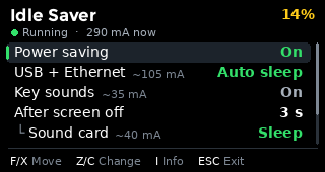
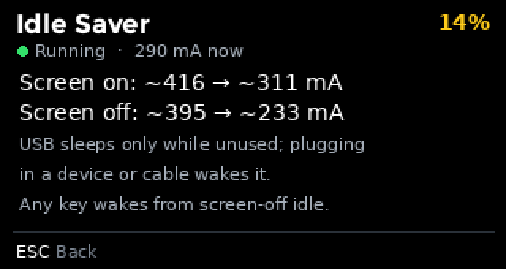

<p align="center"></p>

<h1 align="center">cardzero-idle</h1>

**Longer battery life for the M5Stack CardputerZero, with the screen on and off, plus a low-battery shutdown.**

[中文说明](README.zh-CN.md)

The CardputerZero (Raspberry Pi CM0, BCM2837) has no suspend-to-RAM. Out of the box it draws about 416 mA from the battery with the screen on and idle, and still about 395 mA after the launcher turns the screen off. That is roughly 4.2–4.4 h from the 1750 mAh cell either way.

`cardzero-idle` is a small root daemon that removes most of that waste. On the author's device:

| | Stock | With cardzero-idle | Runtime (1750 mAh) |
|---|---|---|---|
| Screen on, idle | 416 mA | **311 mA** (277 mA with key sounds off) | 4.2 h → 5.6 h (6.3 h) |
| Screen off | 395 mA | **~233 mA** | 4.4 h → 7.5 h |

WiFi, SSH and Tailscale keep working, and USB devices can still be plugged in at any time.

## Idle Saver app

Installing also adds an **Idle Saver** app  to the launcher, so you can change the settings on the device itself.

<p>


</p>

- **Power saving**: turn the whole service on or off.
- **USB + Ethernet**: let the USB bus sleep while nothing is using it (`Auto sleep`), or keep it awake.
- **Key sounds**: `Off` also parks the launcher's audio with the screen on. This silences the launcher's key clicks; other apps' sound is unaffected.
- **After screen off**: how long the screen must be off before the screen-off measures below start (3–60 s).
  - **Sound card**: let it sleep while the screen is off.
  - **Launcher**: pause it while the screen is off.
- **Auto shutdown**: the low-battery shutdown threshold (5–20%, or Never).
- The header shows whether the service is running, the live battery current and the charge level. Press `I` for a short summary.

Green values save power; grey values leave things as they are. Keys follow the launcher's convention: `F`/`X` move, `Z`/`C` or `Enter` change, `I` info, `Esc` back to the launcher. Each change is applied immediately: the app writes `/etc/default/cardzero-idle` through a small root helper and restarts the service.

## What it does

### Always (screen on and off)

| Measure | Saves (measured) | How |
|---|---|---|
| Let the USB bus autosuspend | ~105 mA | The internal SR9900A Ethernet chip (driven by `r8152`) supports runtime suspend, but the kernel leaves it at `power/control=on`. That keeps the GL852G hub and the `dwc2` root hub awake too, at ~8000 interrupts/s. The daemon sets it to `auto`, so with no cable plugged in the whole bus suspends and the interrupts drop to 0. Plugging in a USB device or an Ethernet cable wakes it as usual. |
| Park the launcher's audio stream (optional, off by default) | ~35 mA | See below. With the screen on it costs the launcher's key sounds, so it is opt-in (**Key sounds: Off**). |

### While the screen is off

These start once the backlight has been off for `IDLE_DELAY` seconds.

| Measure | Saves (measured) | How |
|---|---|---|
| Park the launcher's audio stream | ~40 mA | The launcher keeps an audio stream open at all times, so the ES8389 codec and the I2S DMA never stop. The daemon moves that stream to a PipeWire null sink, and the real sound card then suspends. |
| Pause the launcher | ~30 mA | The launcher keeps redrawing the LCD over SPI with the backlight off. It is paused with `SIGSTOP`. This is skipped while an app launched from it is running. |

Wake-up: the daemon watches the keyboard (`tca8418c` evdev device). On any key press it resumes the launcher, which reads the queued key and turns the screen back on, and then moves the audio back. If the backlight comes back on for any other reason, the same restore runs.

The daemon also shuts the system down cleanly (`systemctl poweroff`) when the battery is discharging and at or below `LOW_BATTERY_PERCENT` (default 8%, checked 3 times 20 s apart).

Every change is undone when the service stops, and checked again at startup in case a previous run crashed.

## Measurements

Measured with the on-board BQ27220 fuel gauge (`/sys/class/power_supply/bq27220-0/current_now`), averaged over 30–40 s, WiFi connected, backlight at 30% when on.

Screen on, idle:

| State | Current |
|---|---|
| Stock | 416 mA |
| + USB bus autosuspended | 311 mA |
| + launcher audio parked | 277 mA |

Screen off, each row adding to the one above (the first investigation, battery at about 3.8 V):

| State | Current |
|---|---|
| Stock, screen off | 393 mA |
| + launcher paused | 363 mA |
| + Bluetooth off | 360 mA |
| + CPU capped at 600 MHz | 358 mA |
| + USB host unbound | 268 mA |
| + tailscaled stopped | 260 mA |
| + WiFi off | 222 mA |
| + speaker amp off (GPIO24 low) | 213 mA |
| + LCD blank, HDMI off, camera driver unbound | 212 mA |
| + LEDs off | 209 mA |
| + PipeWire stopped | 173 mA |

Other figures:
- With USB autosuspend, unbinding the USB host controller on top of it made no further difference (233 vs 237 mA), so the daemon no longer unbinds it and hot-plug keeps working.
- The backlight itself costs only ~30 mA. Navigating the launcher UI draws 500–700 mA.
- Bluetooth, CPU frequency, HDMI and the camera made no measurable difference, so the daemon leaves them alone.
- With WiFi off as well, the floor is ~173 mA, which is roughly what the CM0 itself draws.

To measure your own device, use `./measure.sh 30` (no root needed).

## Install

On the CardputerZero:

```sh
git clone https://github.com/InstantComet/cardzero-idle.git
cd cardzero-idle
sudo bash install.sh
```

This installs:
- `/usr/local/sbin/cardzero-idle.py`
- `/etc/systemd/system/cardzero-idle.service` (enabled and started)
- `/etc/default/cardzero-idle` (settings; an existing file is kept)
- The Idle Saver app:
  - `/usr/share/APPLaunch/apps/cardzero-idle/app.py`
  - `/usr/share/APPLaunch/applications/cardzero-idle.desktop`
  - `/usr/share/APPLaunch/share/images/cardzero-idle.png`
  - `/usr/local/lib/cardzero-idle/admin.py` (root helper)
  - `/etc/sudoers.d/cardzero-idle` (lets user `pi` run only that helper without a password)

If the app does not appear in the launcher right away, restart the launcher or reboot.

Check what it is doing with `journalctl -u cardzero-idle -f`. You should see lines like `usb 1-1.1: power/control=auto`, `idle: audio, launcher` and `wake: key`.

To uninstall: `sudo bash uninstall.sh`

## Settings

Use the Idle Saver app, or edit `/etc/default/cardzero-idle` and run `sudo systemctl restart cardzero-idle`.

| Variable | Default | Meaning |
|---|---|---|
| `USB_AUTOSUSPEND` | `1` | Let the internal Ethernet chip, and with it the USB bus, autosuspend. |
| `AUDIO_ALWAYS` | `0` | Park the launcher's audio stream with the screen on too (no launcher key sounds). |
| `IDLE_DELAY` | `5` | Seconds the backlight must stay off before the screen-off measures start. |
| `IDLE_AUDIO` | `1` | Park the launcher's audio stream while the screen is off. |
| `IDLE_STOP_LAUNCHER` | `1` | Pause the launcher while the screen is off. |
| `LOW_BATTERY_PERCENT` | `8` | Shut down at or below this charge while discharging. `0` disables it. |

## Notes and caveats

- Tested on a CardputerZero running Debian 13 (trixie), kernel `6.18.39+rpt-rpi-v8`, and the stock `M5CardputerZero-APPLaunch` launcher. The device user is assumed to be `pi` (uid 1000).
- Screen-off detection reads `/sys/class/backlight/backlight/brightness == 0`, which is what the launcher's screen timeout (Settings > Screen > DarkTime) sets.
- Audio started by another app still plays: only the launcher's own stream is moved, and the launcher is not paused while one of its apps is running.
- The app's helper (`admin.py`) accepts only enable/disable and the exact values the app offers, so the sudoers rule cannot be used to write arbitrary settings.
- The service does not wait for `multi-user.target`. On some images `userconfig.service` (the first-boot "rename user" dialog on tty8) never finishes when booting to the console, and that would block anything ordered after `multi-user.target`. If `systemctl list-jobs` shows it stuck and your user is already set up, `sudo systemctl disable userconfig.service` fixes it.
- Don't unbind and re-bind the `imx219` camera driver at runtime. While measuring, a re-bind oopsed the kernel in `unicam_async_complete`. The daemon does not touch the camera.

## License

MIT
