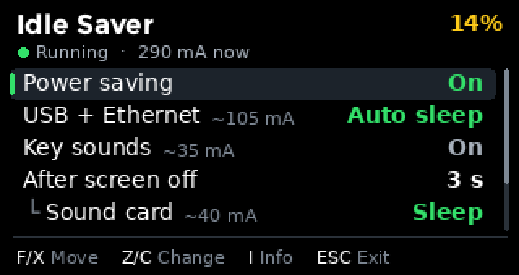
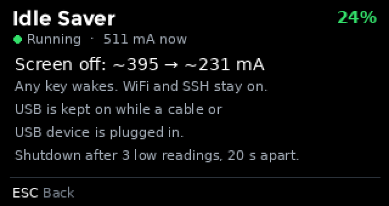

<p align="center"></p>

<h1 align="center">CardputerZero 省电助手 Battery Saver</h1>

**M5Stack CardputerZero 续航优化：亮屏、熄屏都更省电，外加低电量自动关机**

[English](README.md)

CardputerZero 用的是树莓派 CM0（BCM2837），不支持挂起到内存。原厂状态下，亮屏不操作时电池电流约 416 mA；启动器熄屏以后仍有约 395 mA。两种情况下，1750 mAh 的电池都只能撑 4.2–4.4 小时左右。

**Battery Saver**（包名 `cz-battery-saver`）是一个小服务，能去掉大部分白白浪费的电。它以桌面用户 `pi` 运行，不需要 root。在作者的设备上：

| | 原厂 | 装了 Battery Saver | 续航（1750 mAh） |
|---|---|---|---|
| 亮屏不操作 | 416 mA | **311 mA**（关掉按键音时 277 mA） | 4.2 → 5.6 小时（6.3 小时） |
| 熄屏 | 395 mA | **约 233 mA** | 4.4 → 7.5 小时 |

WiFi、SSH 和 Tailscale 照常可用，USB 设备也随时可以插拔。

## Battery Saver 设置 app

安装后，启动器里会多出一个 **Battery Saver**  图标，可以直接在机器上调整设置。

<p>


</p>

- **Power saving**：整个服务的总开关。
- **USB + Ethernet**：选 `Auto sleep` 时，USB 总线在没人用的时候自动休眠；选 `Keep on` 则一直保持唤醒。
- **Key sounds**：选 `Off` 时，亮屏状态下也会挪走启动器的音频流。启动器的按键音会消失，其他 app 的声音不受影响。
- **After screen off**：熄屏多少秒后，执行下面两项熄屏措施（3–60 秒）。
  - **Sound card**：熄屏时让声卡休眠。
  - **Launcher**：熄屏时暂停启动器。
- **Auto shutdown**：低电量关机阈值（5–20%，或 Never 不关机）。
- **HDMI unplugged**（只有装了 [Desk Mode](https://github.com/InstantComet/cz-desk-mode) 才显示）：拔掉 HDMI 1–30 分钟后关闭它的 HDMI 桌面，释放约 55 MB 内存。默认拔掉 1 分钟后关闭（留 1 分钟是为了接头松动不至于直接关掉桌面）；桌面里没保存的东西会丢，不想自动关就选 `Keep desktop`。
- 顶部显示服务是否在运行、实时电池电流和电量。按 `I` 查看简要说明和 CPU 温度。

绿色的值表示正在省电，灰色的值表示保持原样。按键和启动器一致：`F`/`X` 上下移动，`Z`/`C` 或回车修改，`I` 查看说明，`ESC` 回到启动器。修改几秒内生效：app 写入 `/var/lib/cz-battery-saver/settings`，服务会监视这个文件。只有 **USB + Ethernet** 例外：它由 udev 规则在设备出现时应用，所以改了要重启后才生效。

## 做了什么

### 始终生效（亮屏、熄屏都有效）

| 措施 | 实测省电 | 做法 |
|---|---|---|
| 让 USB 总线自动挂起 | ~105 mA | 内置的 SR9900A 网卡（驱动是 `r8152`）支持运行时挂起，但内核默认把它设成 `power/control=on`。这导致 GL852G hub 和 `dwc2` 的 root hub 也一直醒着，每秒约 8000 次中断。软件包里的 udev 规则（`70-cz-battery-saver.rules`）在网卡出现时把它设成 `auto`，没插网线时整条总线都会挂起，中断降到 0。插入 USB 设备或网线时会照常唤醒。 |
| 挪走启动器的音频流（可选，默认关闭） | ~35 mA | 做法见下一节。亮屏时这样做会让启动器的按键音消失，所以需要手动开启（**Key sounds: Off**）。 |

### 熄屏后

背光熄灭 `IDLE_DELAY` 秒后开始执行。

| 措施 | 实测省电 | 做法 |
|---|---|---|
| 挪走启动器的音频流 | ~40 mA | 启动器一直开着一路音频流，导致 ES8389 音频芯片和 I2S DMA 从不停止。守护进程把这路流挪到 PipeWire 的 null sink，真实声卡随之休眠。 |
| 暂停启动器 | ~30 mA | 背光关了以后，启动器仍在通过 SPI 刷屏。守护进程用 `SIGSTOP` 暂停它。如果正在运行从启动器打开的应用，就跳过这一项。 |

**唤醒：** 守护进程监听键盘设备（`tca8418c` 对应的 evdev）。按任意键时，它先让启动器恢复运行，启动器读到缓冲区里的按键，照常点亮屏幕；随后守护进程把音频流挪回去。如果背光因为其他原因亮起，也会执行同样的恢复。

**低电量关机：** 放电状态下，电量连续 3 次（每次间隔 20 秒）都不高于 `LOW_BATTERY_PERCENT`（默认 8%）时，执行 `systemctl poweroff` 安全关机。

**状态恢复：** 服务停止时会撤销所有改动；服务启动时也会检查一遍，防止上次异常退出后留下残余状态。

## 实测数据

用板载电量计 BQ27220（`/sys/class/power_supply/bq27220-0/current_now`）测量，每项取 30–40 秒平均，WiFi 已连接，亮屏时亮度 30%。

亮屏不操作：

| 状态 | 电流 |
|---|---|
| 原厂 | 416 mA |
| + USB 总线自动挂起 | 311 mA |
| + 挪走启动器音频流 | 277 mA |

熄屏，每一行都在上一行的基础上再多关一项（最初的排查，电池电压约 3.8 V）：

| 状态 | 电流 |
|---|---|
| 原厂熄屏 | 393 mA |
| + 暂停启动器 | 363 mA |
| + 关蓝牙 | 360 mA |
| + CPU 锁 600 MHz | 358 mA |
| + 解绑 USB 主控 | 268 mA |
| + 停 tailscaled | 260 mA |
| + 关 WiFi | 222 mA |
| + 关喇叭功放（GPIO24 拉低） | 213 mA |
| + LCD blank、关 HDMI、解绑摄像头驱动 | 212 mA |
| + 关 LED | 209 mA |
| + 停 PipeWire | 173 mA |

其他数据：
- 开了 USB 自动挂起以后，再解绑 USB 主控已经没有额外收益（233 mA 对 237 mA）。所以守护进程不再解绑它，熄屏时也能照常热插拔。
- 背光本身只占约 30 mA；操作界面时电流在 500–700 mA。
- 关蓝牙、降 CPU 频率、关 HDMI、关摄像头几乎测不出差别，所以守护进程不动这几项。
- 连 WiFi 也关掉的话，最低约 173 mA，大致就是 CM0 自身的耗电。

想测自己的设备，可以运行 `./measure.sh 30`（不需要 root）。

## 安装

**从应用商店安装：** 在 CardputerZero 上打开 **Store**，安装 **Battery Saver**（分享码 `BATT`）。

**从源码安装**，在 CardputerZero 上运行：

```sh
git clone https://github.com/InstantComet/cz-battery-saver.git
cd cz-battery-saver
sudo bash install.sh
```

`install.sh` 会用 `build-deb.sh` 打出和商店里一样的 `.deb`（只需要 `dpkg-deb`），再用 apt 安装。如果装过旧版 `cardzero-idle`（本项目以前的名字），它会先卸掉旧版，并保留原来的设置。

软件包会安装：
- `/usr/lib/cz-battery-saver/cz-battery-saver.py`：服务本体
- `/usr/lib/systemd/system/cz-battery-saver.service`（会被启用并立即启动，`User=pi`）
- `/usr/lib/udev/rules.d/70-cz-battery-saver.rules`（USB 自动挂起）
- `/etc/default/cz-battery-saver`（默认配置）
- Battery Saver app：
  - `/usr/share/APPLaunch/apps/cz-battery-saver/app.py`
  - `/usr/share/APPLaunch/applications/cz-battery-saver.desktop`
  - `/usr/share/APPLaunch/share/images/cz-battery-saver.png`

如果启动器里没有马上出现这个 app，重启一下启动器或者整机即可。

用 `journalctl -u cz-battery-saver -f` 查看运行情况，应该能看到 `idle: audio, launcher` 和 `wake: key` 这样的日志。

卸载：`sudo apt remove cz-battery-saver`。USB 自动挂起会保持到下次重启。

## 配置

用 Battery Saver app 修改即可。软件包的默认值在 `/etc/default/cz-battery-saver`；app 里的选择保存在 `/var/lib/cz-battery-saver/settings`，优先级更高。两个文件改动后，服务几秒内就会重新读取。

| 变量 | 默认值 | 含义 |
|---|---|---|
| `ENABLED` | `1` | 总开关（app 里的 **Power saving**），设为 `0` 时下面各项都不生效 |
| `USB_AUTOSUSPEND` | `1` | 让内置网卡自动挂起，USB 总线也随之休眠；重启后生效 |
| `AUDIO_ALWAYS` | `0` | 亮屏时也挪走启动器的音频流（启动器按键音会消失） |
| `IDLE_DELAY` | `5` | 背光熄灭后多少秒开始执行熄屏措施 |
| `IDLE_AUDIO` | `1` | 熄屏时挪走启动器的音频流 |
| `IDLE_STOP_LAUNCHER` | `1` | 熄屏时暂停启动器 |
| `LOW_BATTERY_PERCENT` | `8` | 放电时电量不高于该值就关机，设为 `0` 关闭此功能 |

## 注意事项

- **测试环境：** Debian 13（trixie）、内核 `6.18.39+rpt-rpi-v8`、原厂启动器 `M5CardputerZero-APPLaunch`。默认设备用户是 `pi`（uid 1000）。
- **熄屏判定：** 读取 `/sys/class/backlight/backlight/brightness` 是否为 0。启动器的熄屏超时（设置 > 屏幕 > DarkTime）到了就会把它设为 0。
- **音频播放：** 其他应用的声音照常播放。守护进程只挪启动器自己的音频流，而且启动器有子应用在运行时不会被暂停。
- **运行时不需要 root：** 服务以 `pi` 运行。暂停启动器、挪音频流、读键盘只需要这个用户本来的权限；低电量关机靠原厂镜像里允许 `sudo` 组关机的 polkit 规则；唯一需要 root 的 USB 网卡 `power/control` 由 udev 写入。
- **启动顺序：** 服务不等待 `multi-user.target`。有些系统镜像设置成开机进命令行后，`userconfig.service`（tty8 上的首次开机改名向导）永远不会结束，排在 `multi-user.target` 之后的服务就都启动不了。如果 `systemctl list-jobs` 显示它卡住，而你的用户早已设置好，运行 `sudo systemctl disable userconfig.service` 即可。
- **不要在运行时解绑再重新绑定 `imx219` 摄像头驱动。** 测试时这么做导致内核在 `unicam_async_complete` 里崩溃（oops）。守护进程不会碰摄像头。

## 许可证

MIT
